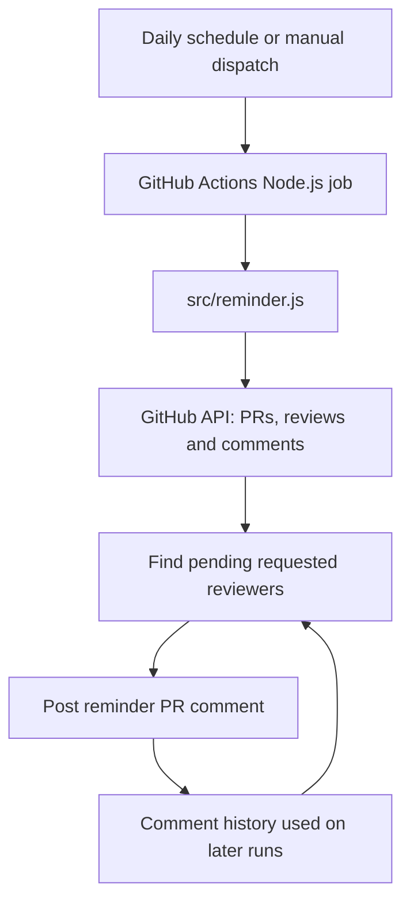

# Pull Request Review Reminder

A scheduled Node.js GitHub Actions workflow that finds requested reviewers who have not submitted a review and posts a reminder comment on the pull request.

**Status:** Runs daily or on manual dispatch with the repository's GitHub token. Existing timing logic can repeat reminders on subsequent runs once a PR is at least three days old.

## Architecture

## Start here

Review [.github/workflows/pr-reminder.yml](.github/workflows/pr-reminder.yml) and [src/reminder.js](src/reminder.js). The workflow needs `pull-requests: write`. For local development, install dependencies with `npm install` and run the included tests with `npm test`.

[Previous README and detailed reference](https://github.com/mtzanida/review-reminder-github-action/blob/660fa00f6c4df28a9ffbb30e9104b90de6a8e0e7/README.md) are retained in Git history. They may describe older assumptions or unmerged plans; the scope above reflects this branch.
